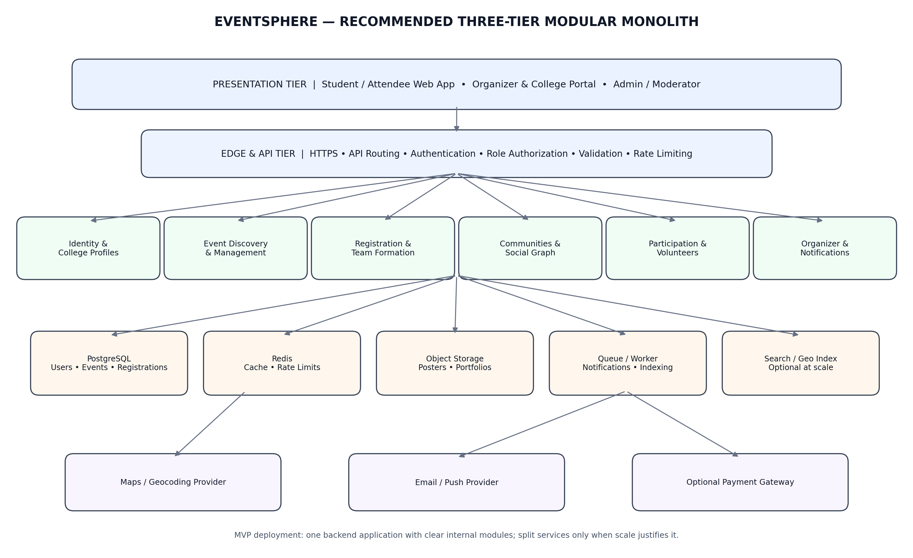

# EventSphere

[](https://github.com/Asijain019/eventsphere/actions/workflows/ci.yml)

EventSphere helps students discover campus and city events, register individually or as teams, and connect with other attendees. Jaipur is the default city.

**Repository:** [github.com/Asijain019/eventsphere](https://github.com/Asijain019/eventsphere)<br>
**Live application:** [eventsphere-rosy-nine.vercel.app](https://eventsphere-rosy-nine.vercel.app/)

## Features

- Search and filter events by city, college, category, date, and price.
- Register individually or as a team; capacity and waitlists are enforced.
- Create events and manage registrations, volunteers, participation, and check-in.
- Join communities, find teammates, and connect with attendees.
- Role-based authentication, profiles, and in-app notifications.

## Technology

Next.js 14 · TypeScript · Tailwind CSS · PostgreSQL · Drizzle ORM · Vitest · Docker

## Architecture



See [docs/ARCHITECTURE.md](docs/ARCHITECTURE.md) for implementation details.

## Run locally

Requirements: Node.js 20+, npm, and Docker.

```powershell
git clone https://github.com/Asijain019/eventsphere.git
cd eventsphere
npm ci
Copy-Item .env.example .env
```

Set `AUTH_SECRET` to a random value in `.env` (generate one with `node -e "console.log(require('crypto').randomBytes(32).toString('base64'))"`). The example environment uses the local PostgreSQL settings from the development Compose file.

```powershell
docker compose -f docker-compose.dev.yml up -d
npm run db:migrate
npm run db:seed
npm run dev
```

Open [http://localhost:3000](http://localhost:3000).

## Docker

From the repository root, build and run the app, PostgreSQL, and demo seed:

```powershell
docker compose up --build
```

The app is available at [http://localhost:3000](http://localhost:3000). To rebuild the app container after changing code or public assets, run `docker compose up --build -d app`.

## Deploy to Vercel

1. Create a PostgreSQL database with a provider such as Neon or Supabase. Keep its connection string private.
2. In Vercel, import `Asijain019/eventsphere` as a new project. Use the repository root as the project root and select Node.js 20.
3. Create a Vercel Blob store for user-uploaded images.
4. Add these environment variables in **Project Settings → Environment Variables** for the environments you use:

   | Variable | Value |
   |---|---|
   | `DATABASE_URL` | PostgreSQL connection string; use SSL for hosted databases |
   | `AUTH_SECRET` | Random secret generated with the command above |
   | `NEXT_PUBLIC_APP_URL` | Your Vercel production URL, e.g. `https://<project>.vercel.app` |
   | `NEXT_PUBLIC_DEFAULT_CITY` | `jaipur` |
   | `STORAGE_PROVIDER` | `blob` |
   | `BLOB_READ_WRITE_TOKEN` | Token from the Vercel Blob store |

5. Apply the database migrations once from the repository root. In PowerShell:

   ```powershell
   $env:DATABASE_URL = "<production PostgreSQL connection string>"
   npm ci
   npm run db:migrate
   Remove-Item Env:DATABASE_URL
   ```

6. Deploy from Vercel or push to the connected GitHub branch. Check that `https://<project>.vercel.app/api/health` returns a healthy response. If you change `NEXT_PUBLIC_APP_URL`, redeploy so the updated value is included in the client build.

Do not run production migrations as part of the Vercel build. Seed demo data only when setting up a demo instance.

## Checks

```powershell
npm run lint
npm run typecheck
npm test
npm run build
```

## Documentation

[API](docs/API.md) · [Deployment](docs/DEPLOYMENT.md) · [Testing](docs/TESTING.md) · [Git workflow](docs/GIT_WORKFLOW.md)
