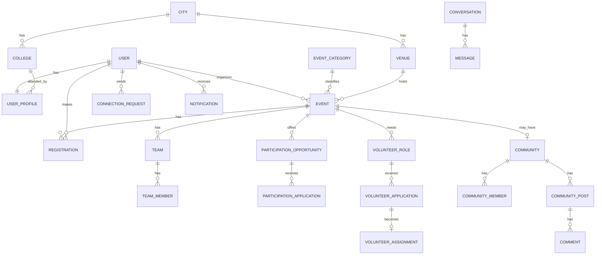

# EventSphere

**Discover. Experience. Connect.** — an inter-college and city-wide event discovery, registration and student-networking platform. Jaipur first, multi-city by design.

> College System Design + DevOps project. Everything below describes what is actually in this repository; items that could not be verified in the build environment are flagged in [Known limitations](#18-known-limitations--future-enhancements).

---

## 1. Description

EventSphere combines District-style local discovery, Eventbrite-style registration and Meetup-style communities. Students and the public can discover events across colleges, register (individually or as teams), apply as performers/contestants or volunteers, join event and interest communities, connect with other attendees and message them once a connection is accepted. Organizers get a dashboard to create and publish events, manage registrations and applications, and post announcements.

## 2. Project objective

Demonstrate a realistic, production-style system: a **three-tier modular monolith** (Next.js UI + API, PostgreSQL, background/queue layer) with authentication and role-based access control, transactional capacity control, privacy-aware social features, containerisation (Docker), CI (GitHub Actions) and a Vercel-ready deployment.

## 3. Features

| Area | What works |
|---|---|
| Auth & profiles | Sign up / log in / log out (bcrypt + signed httpOnly JWT cookie), protected routes, profile editing (bio, college, city, skills, interests, avatar), 5 roles with RBAC |
| Discovery | Search, filters (category, date, city, college, free/paid, online/offline), sort (upcoming / popular / newest), pagination, favourites, multi-city (Jaipur default) |
| Registration | Individual + team registration, duplicate prevention, **capacity enforced in a DB transaction**, waitlist, ticket reference, My Registrations |
| Participation | Performer/contestant applications with a 6-state review workflow |
| Volunteers | Role postings, applications, accept/reject, shift assignment, completion status |
| Communities | Interest communities and per-event communities: members, announcements, posts, comments |
| Connect | Opt-in attendee discovery, connection requests (accept / decline / remove), block / report; **messaging only after acceptance (enforced server-side)** |
| Find My Team | Create teams, publish open roles/skills, join requests, accept/reject |
| Organizer | Create/edit/publish/cancel events, poster upload, registrations, applicants, announcements, analytics, check-in |
| Notifications | In-app notifications via an async in-process queue |
| DevOps | Multi-stage Dockerfile, Docker Compose, GitHub Actions CI, Vercel config, health endpoint |

## 4. Screenshots

> PLACEHOLDER — add screenshots to `docs/screenshots/` and link them here after running the app (home, explore, event detail, organizer dashboard, communities, messages).

| Home | Explore | Event detail |
|---|---|---|
| _screenshot_ | _screenshot_ | _screenshot_ |

## 5. Technology stack

| Layer | Choice |
|---|---|
| Frontend | Next.js 14 (App Router) + TypeScript, Tailwind CSS, Framer Motion, lucide-react |
| Backend | Next.js route handlers (`/api/v1/*`), thin handlers → service modules, Zod validation |
| Database | PostgreSQL 16 |
| ORM | **Drizzle ORM** + `drizzle-kit` SQL migrations |
| Auth | `jose` JWT session cookie + `bcryptjs` |
| Tests | Vitest with **PGlite** (real Postgres engine in-process — no DB service needed) |
| DevOps | Docker (multi-stage), Docker Compose, GitHub Actions, Vercel |

**Honest note — Drizzle instead of Prisma.** The original brief preferred Prisma. Prisma's engine binaries could not be downloaded/verified in the build sandbox, so the project uses **Drizzle ORM**, which is pure TypeScript, fully type-safe and generates plain SQL migrations (`drizzle/0000_init.sql`). The schema design (entities, constraints, indexes) is exactly what the brief asked for; only the ORM differs. (Legacy `prisma` script names in `package.json` are leftovers and are not used.)

Redis appears in `docker-compose.yml` as an **optional** profile only: the MVP rate limiter and notification queue are in-process (see [Architecture](docs/ARCHITECTURE.md)).

## 6. Architecture

```mermaid
flowchart TB
  subgraph Presentation["Presentation tier (Next.js App Router)"]
    A[Attendee UI<br/>explore, event, communities, messages]
    B[Organizer dashboard]
    C[Admin views]
  end
  subgraph Application["Application tier (modular monolith, /api/v1)"]
    R[route&#40;&#41; wrapper<br/>session, RBAC, Zod, error JSON]
    M1[identity]
    M2[events + registration + teams]
    M3[organizer]
    M4[participation + volunteer]
    M5[communities + connections + messaging]
    M6[notifications queue]
  end
  subgraph Data["Data tier"]
    PG[(PostgreSQL)]
    FS[(Image storage<br/>local / Vercel Blob)]
    RD[(Redis — optional)]
  end
  A --> R
  B --> R
  C --> R
  R --> M1 & M2 & M3 & M4 & M5
  M2 & M3 & M4 & M5 -.async.-> M6
  M1 & M2 & M3 & M4 & M5 & M6 --> PG
  M3 --> FS
  R -.future.-> RD
```



ASCII fallback:

```
 Browser ──► Next.js (UI pages + /api/v1 handlers)
              │  route(): session → RBAC → Zod → service
              ├─ modules: identity | events/registration/teams | organizer
              │           participation/volunteer | communities/connections/messaging
              ├─ notify() async queue ──► notifications table
              ▼
         PostgreSQL  (+ image storage: public/uploads or Vercel Blob; Redis optional)
```

Full write-up: [docs/ARCHITECTURE.md](docs/ARCHITECTURE.md). The reference diagram supplied with the project is in `public/assets/ref/architecture.png`.

## 7. Database overview

Defined in `src/db/schema.ts` (source of truth), applied by `drizzle/0000_init.sql`. 33 tables including users, profiles, roles, colleges, organizations, categories, venues, events, media, registrations, teams, communities, posts, comments, connection requests, conversations, messages, participation and volunteer entities, notifications, check-ins and reports. Highlights: composite unique constraints (one registration per user per event, one connection request per pair), indexes on hot filters (city + start date + status), enum-typed statuses.



## 8. Folder structure

```
src/
  app/            pages (server components) + app/api/v1 route handlers
  components/     UI by area (home, events, organizer, communities, ui primitives…)
  modules/        business logic + DB access + Zod schemas per domain
  db/             schema.ts, client, seed.ts + seed-data.ts
  lib/            api wrapper, session, auth, notify queue, storage, images map, constants
drizzle/          generated SQL migrations
scripts/          migrate.ts / migrate.mjs, seed.ts, worker.ts, gen-api-docs.ts
tests/            Vitest suites (+ helpers/db.ts = PGlite harness, infra/ = seed & health)
docs/             ARCHITECTURE, API, DEPLOYMENT, GIT_WORKFLOW, TESTING, SYSTEM_DESIGN_NOTES
public/assets/ref the reference images supplied with the project
.github/          CI workflow, PR template
Dockerfile, docker-compose.yml, docker-compose.dev.yml, docker-entrypoint.sh, vercel.json
```

## 9. Local setup (without Docker for the app)

Prerequisites: **Node.js 20+**, npm, and either Docker (for Postgres) or a local PostgreSQL 14+.

```bash
npm ci
cp .env.example .env                         # then edit AUTH_SECRET (openssl rand -base64 32)
docker compose -f docker-compose.dev.yml up -d   # Postgres on localhost:5432
npm run db:migrate                           # apply migrations
npm run db:seed                              # demo data (idempotent)
npm run dev                                  # http://localhost:3000
```

## 10. Environment variables

| Variable | Required | Description |
|---|---|---|
| `DATABASE_URL` | yes | PostgreSQL connection string. Add `?sslmode=require` for managed DBs (Neon/Supabase). |
| `AUTH_SECRET` | yes | Random string used to sign session JWTs (`openssl rand -base64 32`). |
| `NEXT_PUBLIC_APP_URL` | recommended | Public base URL (e.g. your Vercel URL). Inlined at build time. |
| `NEXT_PUBLIC_DEFAULT_CITY` | no | Default city slug, `jaipur`. |
| `STORAGE_PROVIDER` | no | `local` (dev, writes to `public/uploads`) or `blob` (Vercel Blob; **required on Vercel**). |
| `BLOB_READ_WRITE_TOKEN` | if `blob` | Vercel Blob token. |
| `REDIS_URL` | no | Reserved for the scale-out path; unused by the MVP. |
| Docker Compose only | no | `POSTGRES_USER/PASSWORD/DB`, `APP_PORT`, `DB_PORT` (all have defaults). |

Never commit `.env`. Only `.env.example` is tracked.

## 11. Docker

```bash
docker compose up --build        # db + app (auto-migrates) + one-shot seed → http://localhost:3000
docker compose up --build app    # without demo data
docker compose --profile worker --profile redis up   # optional worker + Redis
docker compose down -v           # stop and delete the database volume
```

The runner image is multi-stage, non-root, has a `HEALTHCHECK` on `/api/health`, and runs `migrate.mjs` before starting the server (details in the `Dockerfile` header). `AUTH_SECRET` falls back to an **insecure dev-only default** in compose; set your own in `.env` for anything public.

## 12. Migrations and seeding

```bash
npm run db:generate   # after editing src/db/schema.ts → new SQL in drizzle/
npm run db:migrate    # apply (tsx scripts/migrate.ts). Plain-JS equivalent: node scripts/migrate.mjs
npm run db:seed       # idempotent demo data
npm run db:reset      # migrate + seed
```

Seed contents: 8 cities, 12 real Jaipur institutions, 12 categories, 18 venues, 32 users, **31 demo events** across all categories (dates always 1–90 days in the future relative to when the seed first ran), registrations (one event full, one with 1 seat left, one waitlist), teams, communities with posts/comments, connections + a conversation, opportunities and volunteer roles with applications in every status, notifications and favourites.

## 13. Testing

```bash
npm test              # Vitest (uses PGlite; no database service required)
npm run lint
npm run typecheck
```

Manual end-to-end scripts for the six journeys in the brief: [docs/TESTING.md](docs/TESTING.md).

## 14. Build

```bash
npm run build && npm start
```

## 15. CI/CD (GitHub Actions)

`.github/workflows/ci.yml` runs on **every push and pull request**:

1. **quality** job: checkout → Node 20 with npm cache → `npm ci` → `npm run lint` → `npm run typecheck` → `npm test` → `npm run build` (dummy env values; no DB needed).
2. **docker** job: Buildx build of the production image (`push: false`) with GitHub Actions layer cache, then a smoke check (non-root user, migration files present).

Deployment is **not** part of the workflow: Vercel's GitHub integration deploys `main` (production) and every PR (preview). CI status is shown on each PR.

## 16. Deployment (Vercel)

Short version (full checklist in [docs/DEPLOYMENT.md](docs/DEPLOYMENT.md)):

1. Create a Postgres database (Neon, Supabase or Vercel Postgres) and copy its connection string.
2. Push the repo to GitHub ([docs/GIT_WORKFLOW.md](docs/GIT_WORKFLOW.md)).
3. In Vercel: **Add New → Project → import the repo** (framework auto-detected as Next.js).
4. Set env vars: `DATABASE_URL`, `AUTH_SECRET`, `NEXT_PUBLIC_APP_URL`, `STORAGE_PROVIDER=blob`, `BLOB_READ_WRITE_TOKEN` (create a Blob store in the Vercel dashboard).
5. Run migrations **once from your machine** against the production DB: `DATABASE_URL="<prod url>" npm run db:migrate`; optionally `npm run db:seed` for demo data.
6. Deploy; verify `https://<your-app>/api/health` returns `{"status":"ok"}`.

Migrations are deliberately run manually (not in the Vercel build) so that a bad build never mutates the production schema and preview deployments cannot migrate the production database.

## 17. Links

| | |
|---|---|
| Live URL | **PLACEHOLDER — add after deploying to Vercel** (`https://<project>.vercel.app`) |
| GitHub repository | **PLACEHOLDER — add after creating the repo** (`https://github.com/<user>/eventsphere`) |

No deployment or repository push has been performed by the tooling that generated this project.

### Demo accounts

All use password `Password123!` (seeded by `npm run db:seed`).

| Role | Email |
|---|---|
| Student | student@eventsphere.dev, student2@eventsphere.dev, student3@eventsphere.dev |
| Organizer | organizer@eventsphere.dev, organizer2@eventsphere.dev |
| College admin | collegeadmin@eventsphere.dev |
| Platform admin | admin@eventsphere.dev |

### Demo-data disclosure

The institutions are real names used only for realism; **every event, person, post, message and registration in the seed is fictional sample data** (events carry `is_demo = true`) and implies no affiliation with those institutions. Venue coordinates are approximate. Remove demo data before any real launch.

### Team contributions

Work division follows the project proposal (Section 13). Replace the names with your own and keep your real git history as evidence.

| Member | Ownership (from the proposal) | Where it lives in the code |
|---|---|---|
| Member 1 — _name_ | Frontend & attendee experience: auth screens, profile, city/college selection, event discovery/filter, event detail, attendee registration, saved events, privacy settings | `src/app/(pages)`, `src/components/events`, `src/components/home`, `src/components/profile` |
| Member 2 — _name_ | Backend, DB & event operations: schema/migrations, auth & roles, event CRUD/publishing, registration/capacity, teams, contestant applications, volunteer workflows | `src/db`, `modules/identity`, `modules/events`, `modules/organizer`, `modules/participation`, `modules/volunteer` |
| Member 3 — _name_ | Communities, social & DevOps: communities, connections, gated messaging, organizer dashboard integration, notifications, Docker, GitHub Actions, deployment, README | `modules/communities`, `modules/connections`, `modules/messaging`, `modules/notifications`, `Dockerfile`, `.github/`, `docs/` |

All members share architecture/ERD review, API contracts, code review, testing and the presentation.

## 18. Known limitations & future enhancements

Limitations (honest list):
- **Docker image and CI workflow were validated statically** (`docker compose config`, YAML parse, migrations + seed against a real PostgreSQL 16 and PGlite). The Docker daemon was unavailable where this was written, so `docker compose up --build` and the GitHub Actions run have **not** been executed — run them once locally/on GitHub.
- Paid events show a price but there is **no payment gateway** (registration is free for the MVP; a payment sandbox is a future integration).
- Local-disk uploads (`STORAGE_PROVIDER=local`) are for development; in the standalone Docker server files added at runtime may only be served after a restart. Use Vercel Blob in production.
- Rate limiting and the notification queue are **in-process** (single instance). Use Redis/BullMQ to scale out.
- Messaging is request/response (no WebSocket push).
- Three requested reference images were **not supplied** (see below).

Future: payments (Razorpay/Stripe), real-time chat (WebSockets/SSE), email/push notifications, search engine indexing, QR check-in scanning app, multi-college admin tooling, moderation dashboard, recommendation engine.

## Reference images

All supplied images are in `public/assets/ref/` and mapped in `src/lib/images.ts`. Three requested references were **not in the project files**: the student brainstorming photograph, the event passes/badges photograph and the EventEase website reference. The app falls back to a branded gradient for those; drop the files into `public/assets/ref/` as `student-brainstorm.jpg`, `event-passes.jpg`, `eventease-ref.jpg` to activate them.

## Further documentation

[Architecture](docs/ARCHITECTURE.md) · [API](docs/API.md) · [Git workflow](docs/GIT_WORKFLOW.md) · [Deployment](docs/DEPLOYMENT.md) · [Testing](docs/TESTING.md) · [System design notes](docs/SYSTEM_DESIGN_NOTES.md)

## Note on reference images
Three images named in the original brief were not in the supplied project files (student brainstorming photo, event passes/badges photo, EventEase site screenshot). The UI shows designed gradient fallbacks there. To activate them, add files named `student-brainstorm.jpg`, `event-passes.jpg` and `eventease-ref.jpg` to `public/assets/ref/`.
